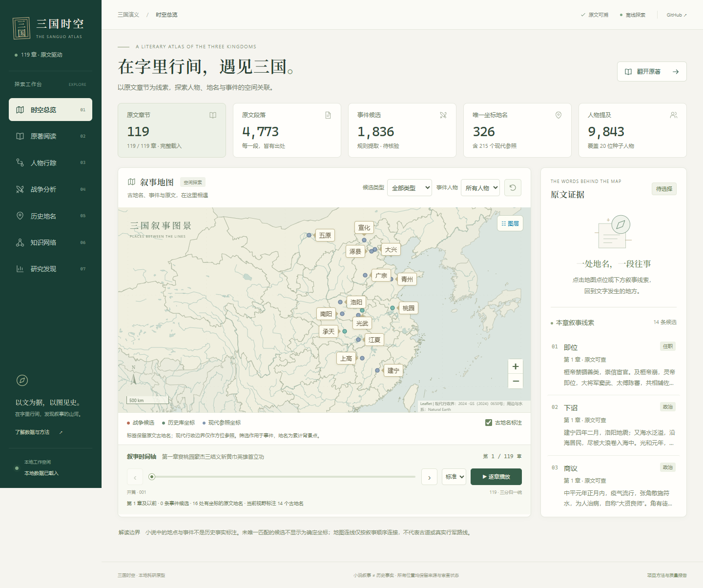
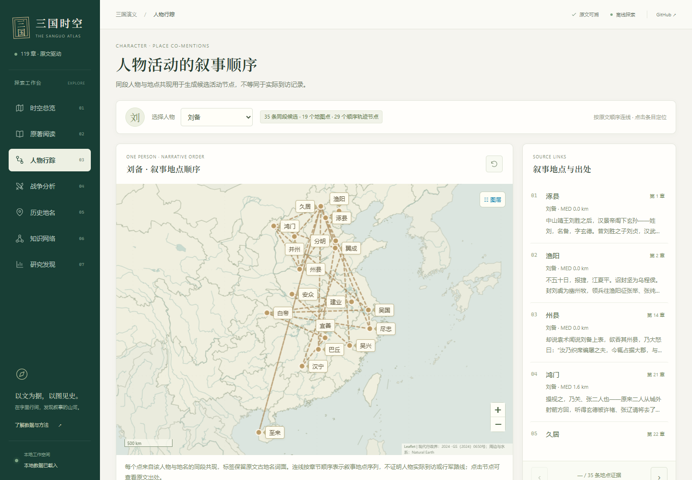

# 三国时空 · 界面设计与交互验收

本次调整将七个页面统一为深青侧栏、暖白工作区和浅色叙事地图。衬线标题、印章标识与低饱和青绿/赭金配色呼应古典文本；导航、筛选和证据操作采用常规工作台布局。

## 页面与交互

- 桌面使用常驻侧栏、当前位置导航和五项真实数据统计；手机使用可折叠菜单。
- 总览突出叙事地图与原文证据，保留章节播放、上一/下一章、人物/事件筛选、古地名开关，增加初始视野复位按钮。
- 当前章节显示真实源标题，播放进度同步；首尾章节按钮禁用；离开总览后暂停播放。
- 古地名标签按屏幕矩形避让；未能放置标签的候选仍保留地图点位，不改变任何地名、坐标或匹配结论。
- 现代 2024 行政区界继续使用用户提供的数据，随缩放切换省、市、县；水系独立置于陆地之上。地图明确说明现代边界仅作方位参照。
- 单人物轨迹保持独立展示和切换，线型与节点配色更加克制，点选证据列表高亮并定位对应地图点。
- 原著阅读、地名表、战争分析、知识网络、研究发现共享表单、卡片、字体和留白规则。
- 修复 `selectPlace` 中未定义 `content` 导致的证据面板报错；从地名表选择后会进入总览并显示该地名证据。
- 事件类型与匹配状态展示中文，原始状态和来源数据保持原值；可点击记录支持键盘 Enter/空格，菜单支持 Escape，支持系统减少动画偏好。

## 保留的数据边界

此次变更限于 `frontend/` 与浏览器验收脚本/产物，未修改语料、抽取结果、历史地名志、2024 行政界、几何坐标、MED、空间分析输出或任何科研算法。人物轨迹仍是原文同段共现的叙事地点顺序，不代表已证实实际到访路线。

## 验证结果

2026-10-25 本地验收：

- 原有 pytest：**8 passed**。
- Chrome 浏览器功能检查：**25 passed**，报告为 [`outputs/ui/ui-validation.json`](../outputs/ui/ui-validation.json)。
- 七个页面分别检查 1440×1000、1024×900、390×844、320×740 四种视口，无整页横向溢出；地名表和知识网络在窄屏内保留自身横向滚动，不压缩掉坐标、候选列或节点文字。
- 浏览器验证覆盖章节首尾/播放、古地名开关、省市县图层切换（42/388/2898 要素）、事件跳转原文、全文检索、前三名人物的独立轨迹、地名表键盘选择、知识网络、手机导航与暂停后台播放。
- 验收期间 JavaScript 错误、HTTP 失败、站外请求均为 **0**。
- JavaScript 语法检查、Git 差异空白检查通过。

浏览器检查依赖开发机已有的 Playwright 与 Chrome，不属于运行页面所需的依赖。在已安装 Playwright 的环境中，先启动服务，再运行：

```powershell
node scripts/check_frontend.cjs
```

如果复用其他目录的 Playwright，可用环境变量 `SANGUO_PLAYWRIGHT_PATH` 指定该模块的本地路径；默认检查 `http://127.0.0.1:8765/`，可通过 `SANGUO_UI_URL` 覆盖。

## 页面截图





手机与其余页面的实测截图位于 `outputs/ui/`。截图验收使用减少动画模式以避免截取切页过渡帧；正常访问仍保留轻量过渡效果。

## 第二轮细节优化

- 将主要小字、正文和操作提示放大并提高对比度，统一筛选、禁用、焦点、选中、空结果与加载失败状态；移动端扩大操作按钮。
- 总览缩减无效留白，调整地图高度；区分历史库与现代参照点图例，标注同时避开其他标签与地图控件。事件筛选同步更新当前章节证据；明确背景地名仍为累计显示。
- 播放支持慢速、标准和快速；手机将播放与速度放到独立一行，并实测 320/390px 下互不遮挡。
- 阅读支持目录查找、真实源文件序号、上一/下一章、16–24px 字号及本地字号记忆。原始章名仍完整保留，包括源序号 65 从“第一章”重新编号的事实。
- 全文搜索展示全部命中章节，修正首个命中位置被错误偏移到下一段的问题；支持清除标记与明确的无结果提示。
- 地名清单改为每页 50 条，支持中文匹配状态检索、分页计数和空结果重置；坐标、MED、来源时期分行展示。未伪造顺序或将现有清单称为历史时间排序。
- 人物证据列表显示真实段落摘要，并支持逐条定位、前后切换、地图点选同步高亮与完整视野复位。路线节点、排序和坐标保持不变。
- 知识网络增加直接邻居高亮、键盘选择、取消选择及真实段落摘要，明确当前显示的是高频样本；线条不再截获节点点击。
- 战争分析可独立开关已有核密度、缓冲、事件点图层；只改变展示，不重新生成或拟合分析结果。长英文状态改为中文摘要，原状态保留在提示属性。
- 来源信息保持可见并提供复制入口；长页面增加返回顶部，移动导航支持点击外部关闭。

新增浏览器验收由 `scripts/check_frontend_details.cjs` 承载，并由 `scripts/check_frontend.cjs` 统一执行。所有段落摘要均从已载入的真实章节正文取得，未添加生成式文本或外部请求。
